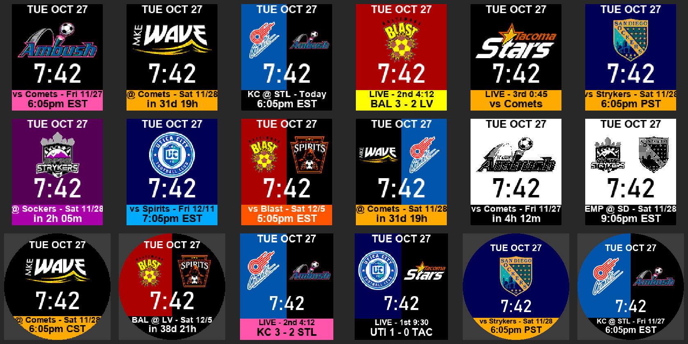

# MASL Watchface

A Pebble watchface for Major Arena Soccer League (MASL) fans. Pick a team to
get its logo big on the face, in its colors, with its next game underneath.
With no team picked, it shows the league's next game with both logos on a
background split down the middle.

It uses the same DigitalShift score ticker as the MASL Scores app (see
`MASL Scores — Data Sources Handoff.md`).



`mockup.png` is drawn with stand-in fonts by a script, not taken from the
emulator, so spacing on a real watch will differ slightly.

## Features

- Time (12/24 hour follows the watch setting), with optional seconds in a
  smaller font, plus a large team logo
- A top row with three spots, left, middle and right, each holding the date,
  the weather, the battery, Bluetooth, the battery and Bluetooth together,
  steps today, heart rate, the Quiet Time bell, or the UV index.
  By default: weather, date, battery and Bluetooth. On rectangular watches
  the middle is balanced between the other two (or the screen edge where one
  is empty) or centered on the screen. Round watches have no corners, so
  there the three are packed together in order and centered. When the row
  doesn't fit, the date drops the month or the weekday (your choice)
- Date formats: `WED NOV 5`, `WED 5`, `NOV 5`, `5 NOV`, `WED 11/5`,
  `WED 5/11`, `11/5`, `5/11` or `2026-11-05`
- Team color themes: background, plus a game bar in the team's primary or
  secondary color, or any custom color. The background can be a custom color
  too; with a light one the time and date turn black
- Optional weather where your phone is: the temperature, a small icon, or
  both (sun, moon, partly cloudy day or night, cloudy, fog, rain, snow,
  storm), in whichever top row spot is set to Weather. Hidden if it hasn't
  updated in 2 hours
- Battery indicator: on color watches it turns yellow when low (40% or less
  by default), red when critical (20% or less by default), and green while
  charging. Both levels can be changed in settings. It can show the icon,
  the percentage (`80%`), or both
- UV index (`UV 7`) from the same Open-Meteo weather, shown only when it's
  high (6 or more by default; 3, 8 or 11 can be picked instead) or always.
  It can also switch into a spot while it's high
- Bluetooth indicator: shown only while the phone is disconnected (with a
  slash through it, red on color watches), always, or never
- Steps today (`8432`, then `12.3k`) and the latest heart rate, each with a
  small icon, from the watch's health data. Heart rate is hidden on watches
  without a sensor
- Optional heart rate every minute while your team's game is live. The face
  asks the watch for one-minute readings when the game goes live, and
  cancels the request when it ends, when the face closes, or when the
  setting is off, so the watch goes back to its own schedule
- Spots that switch when something matters: one can show the battery when
  it's low, one Bluetooth while the phone is disconnected,
  and one heart rate while your team's game is live. Each switches back
  afterwards, and does nothing if its item is already in another spot. If
  more than one picks the same spot, Bluetooth comes first, then the
  battery (the two share the spot when both apply), then heart rate
- Split view: your team's next game with both logos, the background split
  between the two teams' colors, and the bar in your team's accent color
- League mode (no team picked): the next game anywhere in the MASL, always in
  split view with a black bar
- When your team has no game listed: say `No games listed` (the default), or
  show the league's next game instead, either keeping your team's logo and
  colors or switching to league mode until your team has a game again
- Game bar:
  - Scheduled: `@ Wave - Sat 11/28` over the start time or a countdown
    (`in 3d 4h`, `in 2h 05m`, `in 12m`; or down to minutes, `in 3d 4h 12m`;
    or down to seconds, `3d 04:12:30` / `in 1:59:42`). Shows `Today` on game day.
    Start times follow the watch's 12/24 hour setting, or are always one or
    the other (`7:05pm EST` / `19:05 EST`).
  - Live: `LIVE - 2nd 4:12` over the score, or over the opponent in
    no-spoilers mode
  - Final (scores on only): `FINAL` over the score, for up to 6 hours after
    the start time, unless the next game is sooner
- Larger text, set separately for the top row and the game bar. Each goes
  up one font size; the larger bar is a little taller and moves the time up.
  When a tall logo no longer fits, the team's smaller logo is drawn instead.
- A choice of font and size for the time, from the watch's built-in digit
  fonts: LECO (42 or 28, the default is 42), LECO Bold (38, 36 or 32),
  Bitham (42 or 34) or Roboto Bold (49). The digits stay just above the game
  bar and the logo's space grows or shrinks to make room. When the time
  (with seconds, if they're on) is too wide for the screen, the next size
  down in that font is used
- Quick view: while a timeline peek covers the bottom of the screen, the time
  and game bar slide up above it and the logo is hidden, on every watch. Or,
  if chosen, the logo stays: the time moves up just above the peek, the peek
  covers the game bar, and the top row is hidden to make room
- Black-and-white watches get dithered logos on a white face

## Settings

| Setting | Options | Default |
| --- | --- | --- |
| My team | None (league's next game), or one of the 9 teams | None |
| Layout | Big team logo / Split view (only with a team picked) | Big team logo |
| Game bar color (color watches) | Team primary / Team secondary / Custom | Team primary |
| Custom bar color | Any Pebble color, used when the bar color is Custom | Teal (`00AAAA`) |
| Background color (color watches) | Team color / Custom (selected team only, in split view too) | Team color |
| Custom background color | Any Pebble color, used when the background is Custom | Black |
| Show weather | Off / Temperature / Icon / Temperature and icon | Off |
| Units | Fahrenheit / Celsius | Fahrenheit |
| Left / Middle / Right | Empty / Date / Weather / Battery / Bluetooth / Battery and Bluetooth / Steps today / Heart rate / Quiet Time (a bell, crossed out while on) / UV index | Weather / Date / Battery and Bluetooth |
| Middle position | Balanced between left and right (or the screen edge) / Centered on the screen (rectangular watches) | Balanced |
| Date format | `WED NOV 5` / `WED 5` / `NOV 5` / `5 NOV` / `WED 11/5` / `WED 5/11` / `11/5` / `5/11` / `2026-11-05` | `WED NOV 5` |
| When the row is full, drop the | Month / Weekday (only for formats with both; ISO drops the year) | Month |
| Time font | LECO / LECO Bold / Bitham / Roboto Bold | LECO |
| Time size | LECO: 42 / 28. LECO Bold: 38 / 36 / 32. Bitham: 42 / 34. (Roboto Bold has one size, 49) | Largest |
| Show seconds | On / off | Off |
| Only while the backlight is on | On / off (shows seconds for about 4 seconds after a wrist flick) | Off |
| Show battery | Always / When low or charging / Never | Always |
| Battery shows | Icon / Percentage / Icon and percentage | Icon |
| Show UV index | Only when high / Always (when a spot is set to UV index) | Only when high |
| UV index is high at | 3 / 6 / 8 / 11 or more | 6 |
| When the UV index is high, show it in | Off / Left spot / Middle spot / Right spot | Off |
| Larger top row text | On / off | Off |
| Larger game bar text | On / off | Off |
| When Quick View covers the bottom | Move the time and game bar up (hides the logo) / Keep the logo and move the time up (hides the top row and game bar) | Move up |
| Battery is low at | 10% to 60% or less, in steps of 10 | 40% |
| Battery is critical at | 10% to 40% or less, in steps of 10 (kept 10% under low) | 20% |
| Show Bluetooth | Only when disconnected / Always / Never | Only when disconnected |
| When the battery is low, show it in | Off / Left spot / Middle spot / Right spot | Off |
| When the phone disconnects, show Bluetooth in | Off / Left spot / Middle spot / Right spot | Off |
| When Quiet Time is on, show it in | Off / Left spot / Middle spot / Right spot | Off |
| Home games only | On / off (only with a team picked) | Off |
| When my team has no game listed | Say "No games listed" / League's next game, keep my team's logo and colors / League's next game in league mode (only with a team picked) | Say "No games listed" |
| Show | Start time / Countdown to start | Start time |
| Countdown shows | Days and hours / Down to minutes / Down to seconds | Days and hours |
| Start times in | Eastern (as listed) / My time zone / Home team's time zone | Eastern |
| Start time clock | Same as the watch's clock / 12 hour / 24 hour | Same as the watch |
| Show scores | Off = no spoilers: period and clock only, finals skipped | Off |
| Update scores every | 1 / 2 / 5 minutes | 1 minute |
| Heart rate every minute during my team's games | On / off (needs a team and a heart rate sensor) | Off |
| During my team's games, show heart rate in | Off / Left spot / Middle spot / Right spot | Off |

## How refreshing works

The phone picks the game and sends it to the watch in one message, along with
how many minutes until the watch should ask again. The watch counts that down
on its minute tick and asks; it also asks whenever the phone reconnects. The
last game is saved on the watch, so the face isn't blank on start.

Display settings travel in a separate message, sent only when the face starts
and when the settings page closes, so each game update stays small (about 140
bytes of the watch's 512-byte inbox).

| Situation | Next check |
| --- | --- |
| Between games | Hourly, or right at the start time if that's sooner |
| Start time passed, not live yet | Every 5 minutes |
| Live, scores on | The "Update scores every" setting |
| Live, scores off | Every 5 minutes (just to notice the end) |
| Showing a final | Every 30 minutes |
| Fetch error | 15 minutes |

With weather on, the watch asks at least every 30 minutes, and the phone
fetches the weather from [Open-Meteo](https://open-meteo.com/) (free, no key)
when it's at least 25 minutes old. The phone's location is rounded to about a
kilometer before it's sent.

The face redraws once a minute. It switches to every second only while
something on screen shows seconds: the clock with seconds on (or, with
"only while the backlight is on", for a few seconds after a wrist flick), or a running
countdown set to seconds. That costs noticeably more battery, which is why
both are off by default.

Every minute during a live game is fine for battery: it's about 120 small
messages over a two-hour game, and the face is idle the rest of the time. The
phone does the web request.

## Project layout

| File | Purpose |
| --- | --- |
| `src/c/main.c` | Watchface: layout per screen shape, team table (background, primary and secondary bar colors, abbreviations), drawing, AppMessage handling |
| `src/pkjs/index.js` | Phone side: fetches and parses the ticker, picks the game, formats start times, fetches the weather |
| `src/pkjs/config.js` | Settings page ([Clay](https://github.com/pebble-dev/clay)) |
| `src/pkjs/config-custom.js` | Settings page script: hides "drop the" for date formats it doesn't apply to |
| `src/pkjs/teams.js` | Team names, full names and arena time zones |
| `logos_src/` | Full-size team logos (from the ticker's image links) |
| `resources/images/<shape>/` | Converted logos: `logo_` (big) and `half_` (split view) per screen shape |
| `tools/convert_logos.py` | Converts `logos_src/` into `resources/images/` |
| `tools/gen_resources.py` | Rewrites the logo list in `package.json` |

Logo sizes per screen shape (also in `tools/convert_logos.py`):

| Shape | Platforms | Big logo | Half logo |
| --- | --- | --- | --- |
| `rect` | basalt | 128×72 | 64×58 |
| `bw` | diorite, flint | 128×72 | 64×58 |
| `chalk` | chalk | 112×64 | 62×54 |
| `emery` | emery | 176×100 | 90×84 |
| `gabbro` | gabbro | 184×104 | 104×92 |

The 24×20 `resources/images/logo_*.png` files copied from MASL Scores aren't
used by the face.

## Building

With the Pebble SDK installed:

```bash
pebble build
pebble install --emulator basalt
```

Use `@rebble/clay`, not the original `pebble-clay`, which breaks the `flint`
build.

CloudPebble's emulator can't get a location (its phone simulator fails with
`name 'Position' is not defined`), so weather never shows there. Check the
weather on a real watch.

## App store screenshots

```bash
tools/screenshots.sh
```

This builds the face in demo mode, takes one screenshot per demo scene on
every platform's emulator, and saves them to `screenshots/<platform>/`. It
needs the Pebble SDK. To do only some platforms, name them:
`tools/screenshots.sh basalt chalk`. If shots come out half drawn, give the
face more time with `SETTLE=4 tools/screenshots.sh`.

In demo mode the clock stops at a set time, the phone's messages are
ignored, and the face shows made-up scenes with weather (which the emulator
can't get otherwise). A tap moves to the next scene:

1. Team view: the Wave's next game
2. Split view: a live Comets at Ambush game with scores
3. League mode with a countdown
4. A Strykers final on a light custom background, with seconds

To change a scene, edit `demo_scene()` in `src/c/main.c`. If you add or
remove one, update `SCENES` in the script too.

The script finishes with a normal build, so the `.pbw` it leaves is safe to
release. In CloudPebble, uncomment `#define MASL_DEMO` near the top of
`main.c`, take the screenshots with the emulator's screenshot button
(tapping between scenes), and comment it out again before you release.

To regenerate logos after changing sizes or adding a team (requires Pillow):

```bash
python tools/convert_logos.py
python tools/gen_resources.py
```

## Adding a team

1. Save its logo as `logos_src/<team>.png` (short name, lowercase). The
   ticker HTML has an `` link to each logo; drop `-small` from the URL
   for the full-size one.
2. Run the two scripts above.
3. Add the team to `s_teams` in `src/c/main.c` (name, abbreviation, colors)
   and to `src/pkjs/teams.js` (full name, arena time zone).

If a logo is mostly black or the team's background color, add a swap to
`RECOLOR` in `tools/convert_logos.py` (Wave and Stars have one).

## Status and caveats

- Not tested on round hardware (chalk and gabbro). Their layouts have only
  been checked in the emulator and on a desktop, so spacing near the curved
  edge may be off on a real round watch.
- Running on a Pebble Time 2 (emery) and in CloudPebble's emulator. The C
  code has also been type-checked against a stub header, and the phone code
  tested in Node against the live ticker and a made-up live/final game.
- The three-spot top row, Bluetooth icon, steps, heart rate, date formats
  and 24 hour start times are type-checked, and the row placement and formatting were run on
  a desktop with estimated font widths. Spacing needs a look in the
  emulator, especially on round watches with weather, battery and Bluetooth
  all showing.
- Weather and custom background are type-checked and the weather fetch was
  tested in Node against the live Open-Meteo API, but their placement on
  screen (especially the weather next to the date on round watches) needs a
  look in the emulator.
- Larger text, battery percentage, the UV index and the keep-the-logo
  Quick View are not yet built or checked in the emulator. Their positions
  are estimated from font sizes, so they need a look on every platform,
  especially round watches with the larger game bar.
- Time fonts other than the default are not yet checked on a watch. Where
  each font's digits sit in its line box is estimated (the `top` and
  `bottom` numbers in `s_time_fonts` in `src/c/main.c`), so the time may sit
  a few pixels high or low until those are tuned.
- Score, live and final parsing are untested against real games until the
  season starts (Nov 27, 2026). Same caveat as MASL Scores.
- The ticker lists about a month of games (20 as of Oct 27, 2026). A team with
  nothing in that window shows `No games listed`.
- The site ticket in `src/pkjs/index.js` rotates. `Error 401`/`403` on the
  face means it needs a fresh one (see the handoff doc).

## Disclaimer

Unofficial fan project for personal use. Not affiliated with or endorsed by
the MASL, its teams or DigitalShift. Team logos belong to their owners. Check
MASL's terms before publishing to the Pebble appstore.
