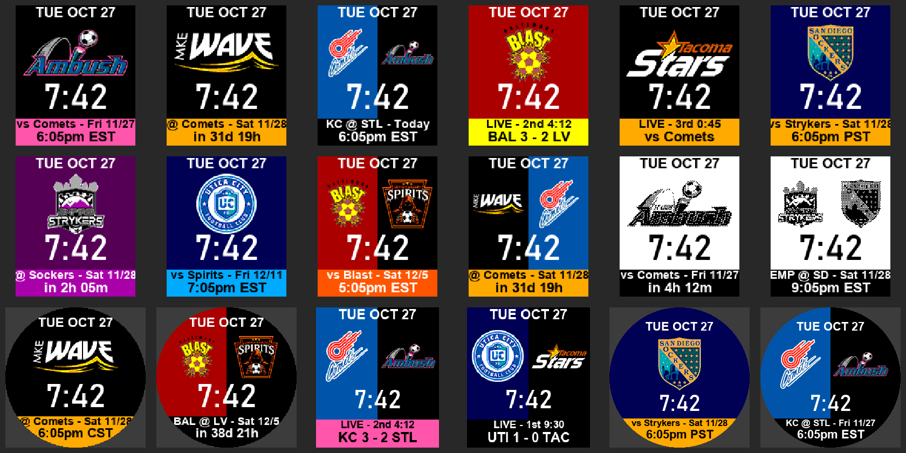

# MASL Watchface

A Pebble watchface for Major Arena Soccer League (MASL) fans. Pick a team to
get its logo big on the face, in its colors, with its next game underneath.
With no team picked, it shows the league's next game with both logos on a
background split down the middle.

It uses the same DigitalShift score ticker as the MASL Scores app (see
`MASL Scores — Data Sources Handoff.md`).



`mockup.png` is drawn with stand-in fonts by a script, not taken from the
emulator, so spacing on a real watch will differ slightly.

## Features

- Time (12/24 hour follows the watch setting), date, and a large team logo
- Team color themes: background, plus an accent color for the game bar
- Split view: your team's next game with both logos, the background split
  between the two teams' colors, and the bar in your team's accent color
- League mode (no team picked): the next game anywhere in the MASL, always in
  split view with a black bar
- Game bar:
  - Scheduled: `@ Wave - Sat 11/28` over the start time or a countdown
    (`in 3d 4h`, `in 2h 05m`, `in 12m`). Shows `Today` on game day.
  - Live: `LIVE - 2nd 4:12` over the score, or over the opponent in
    no-spoilers mode
  - Final (scores on only): `FINAL` over the score, for up to 6 hours after
    the start time, unless the next game is sooner
- Black-and-white watches get dithered logos on a white face

## Settings

| Setting | Options | Default |
| --- | --- | --- |
| My team | None (league's next game), or one of the 9 teams | None |
| Layout | Big team logo / Split view (only with a team picked) | Big team logo |
| Home games only | On / off (only with a team picked) | Off |
| Show | Start time / Countdown to start | Start time |
| Start times in | Eastern (as listed) / My time zone / Home team's time zone | Eastern |
| Show scores | Off = no spoilers: period and clock only, finals skipped | Off |
| Update scores every | 1 / 2 / 5 minutes | 1 minute |

## How refreshing works

The phone picks the game and sends it to the watch in one message, along with
how many minutes until the watch should ask again. The watch counts that down
on its minute tick and asks; it also asks whenever the phone reconnects. The
last game is saved on the watch, so the face isn't blank on start.

| Situation | Next check |
| --- | --- |
| Between games | Hourly, or right at the start time if that's sooner |
| Start time passed, not live yet | Every 5 minutes |
| Live, scores on | The "Update scores every" setting |
| Live, scores off | Every 5 minutes (just to notice the end) |
| Showing a final | Every 30 minutes |
| Fetch error | 15 minutes |

Every minute during a live game is fine for battery: it's about 120 small
messages over a two-hour game, and the face is idle the rest of the time. The
phone does the web request.

## Project layout

| File | Purpose |
| --- | --- |
| `src/c/main.c` | Watchface: layout per screen shape, team table (colors, abbreviations), drawing, AppMessage handling |
| `src/pkjs/index.js` | Phone side: fetches and parses the ticker, picks the game, formats start times |
| `src/pkjs/config.js` | Settings page ([Clay](https://github.com/pebble-dev/clay)) |
| `src/pkjs/teams.js` | Team names, full names and arena time zones |
| `logos_src/` | Full-size team logos (from the ticker's image links) |
| `resources/images/<shape>/` | Converted logos: `logo_` (big) and `half_` (split view) per screen shape |
| `tools/convert_logos.py` | Converts `logos_src/` into `resources/images/` |
| `tools/gen_resources.py` | Rewrites the logo list in `package.json` |

Logo sizes per screen shape (also in `tools/convert_logos.py`):

| Shape | Platforms | Big logo | Half logo |
| --- | --- | --- | --- |
| `rect` | basalt | 128×72 | 64×58 |
| `bw` | diorite, flint | 128×72 | 64×58 |
| `chalk` | chalk | 112×64 | 62×54 |
| `emery` | emery | 176×100 | 90×84 |
| `gabbro` | gabbro | 184×104 | 104×92 |

The 24×20 `resources/images/logo_*.png` files copied from MASL Scores aren't
used by the face.

## Building

With the Pebble SDK installed:

```bash
pebble build
pebble install --emulator basalt
```

Use `@rebble/clay`, not the original `pebble-clay`, which breaks the `flint`
build.

To regenerate logos after changing sizes or adding a team (requires Pillow):

```bash
python tools/convert_logos.py
python tools/gen_resources.py
```

## Adding a team

1. Save its logo as `logos_src/<team>.png` (short name, lowercase). The
   ticker HTML has an `` link to each logo; drop `-small` from the URL
   for the full-size one.
2. Run the two scripts above.
3. Add the team to `s_teams` in `src/c/main.c` (name, abbreviation, colors)
   and to `src/pkjs/teams.js` (full name, arena time zone).

If a logo is mostly black or the team's background color, add a swap to
`RECOLOR` in `tools/convert_logos.py` (Wave and Stars have one).

## Status and caveats

- Not yet run in the emulator or on a watch. The C code has been
  type-checked against a stub header, and the phone code tested in Node
  against the live ticker and a made-up live/final game.
- Score, live and final parsing are untested against real games until the
  season starts (Nov 27, 2026). Same caveat as MASL Scores.
- The ticker lists about a month of games (20 as of Oct 27, 2026). A team with
  nothing in that window shows `No games listed`.
- The site ticket in `src/pkjs/index.js` rotates. `Error 401`/`403` on the
  face means it needs a fresh one (see the handoff doc).

## Disclaimer

Unofficial fan project for personal use. Not affiliated with or endorsed by
the MASL, its teams or DigitalShift. Team logos belong to their owners. Check
MASL's terms before publishing to the Pebble appstore.
